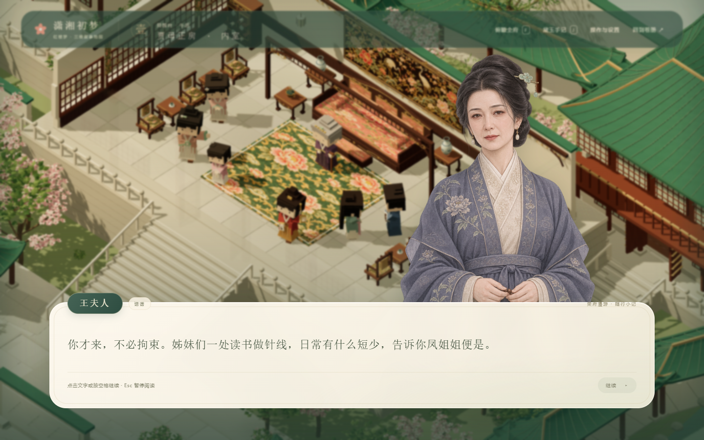

# 三维贾府漫游 · 对话立绘版 V11.5

《潇湘初梦》第一幕“黛玉进贾府”的独立三维探索模式。斜俯视镜头下控制方块小黛玉在院落、曲廊、亭台、假山和八间内室中自由探索，交谈时使用原有水彩立绘和纸笺对话。



## 直接运行

推荐安装 Node.js 22.12 或更高版本。此目录的 `dist/` 已包含可运行页面，无需先安装 npm 依赖。

在仓库根目录执行 `npm run start:3d`，或在本目录执行 `node server.mjs`，打开 http://127.0.0.1:4177/ 。Windows 也可双击本目录的 `启动贾府漫游.cmd`。

[下载包含完整地图模型的试玩包](https://github.com/nayoagan-ship-it/xiaoxiang-first-dream/releases/tag/jiafu-v11.5.0)，完整解压后双击启动脚本。现有公开网址是二维阅读版；三维漫游版使用本机服务运行。

## 本版内容

- 八片连通区域与八间可进入的内室，建筑、地形有明显高差，保留假山穿洞、登亭石阶和曲折水桥。
- 玩家黛玉、八位具名NPC及两位门前人物。人物有不同站姿、小方眼、眨眼、呼吸和交谈回应，靠近时转向黛玉。
- 十位可交谈人物及原篇通报丫鬟都有对应水彩立绘；黛玉回应或心声时切回黛玉。快速翻页和暂停可正确清理旧图像。
- 保留原篇选择、心境分数、阅读续接、物件交互、手记、开门状态和独立浏览器存档。

操作：WASD / 方向键移动，点击地面寻路，E交互，F切换俯瞰 / 跟随，滚轮缩放，J手记，M地图，Esc暂停。对话中空格 / 回车继续，数字1/2/3选择。面向电脑浏览器设计。

## 继续开发

```sh
cd jiafu-3d
npm ci
npm run dev
```

开发地址为 http://127.0.0.1:4176/ 。`npm run build` 更新 `dist/`，`npm run check` 检查入口语法，`npm test` 检查方块几何与人物动作。

可选浏览器检查需 Playwright：`npm install --no-save --package-lock=false playwright`、`npx playwright install chromium`。保持开发服务运行后执行 `node tools/check-dialogue-portraits.cjs`。使用本机浏览器时，可设置 `JIAFU_BROWSER_EXECUTABLE`；复用外部 Playwright 时可设置 `JIAFU_PLAYWRIGHT_PACKAGE` 为其模块路径。

## 目录与模型

`src/` 为地图、建筑、室内、植被、人物与对话逻辑；`public/assets/` 为运行素材；`tools/` 为模型导出与验证工具；`outputs/` 为实际渲染截图及检查记录。

`assets/jiafu-block-characters-v11.blend` 和 `.glb` 包含独立九人可编辑模型。完整地图的BLEND/GLB体积较大，随Release试玩包提供。也可执行 `node tools/export-map.mjs`，再用Blender后台运行 `tools/save-blender-map.py` 重建整府和九人模型。

模型保存当前姿态与分组层级；呼吸、眨眼、交谈与屋顶剖开由网页代码实时驱动，未烘焙为模型动画片段。

新增立绘使用内置image_gen，以原有黛玉立绘为参考，说明及完整提示词见 [ASSET-NOTES.md](public/assets/portraits-v11/ASSET-NOTES.md) 和 [prompts.json](public/assets/portraits-v11/prompts.json)。人物与空间为小说游戏的艺术化设计。

项目代码沿用仓库根目录MIT许可；Three.js许可保留于 `THREE-LICENSE.txt`。新增素材与源代码一同提供，既有素材及署名说明见仓库根目录 `SOURCES.md`。
