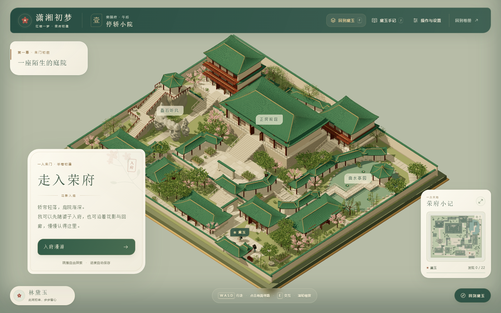
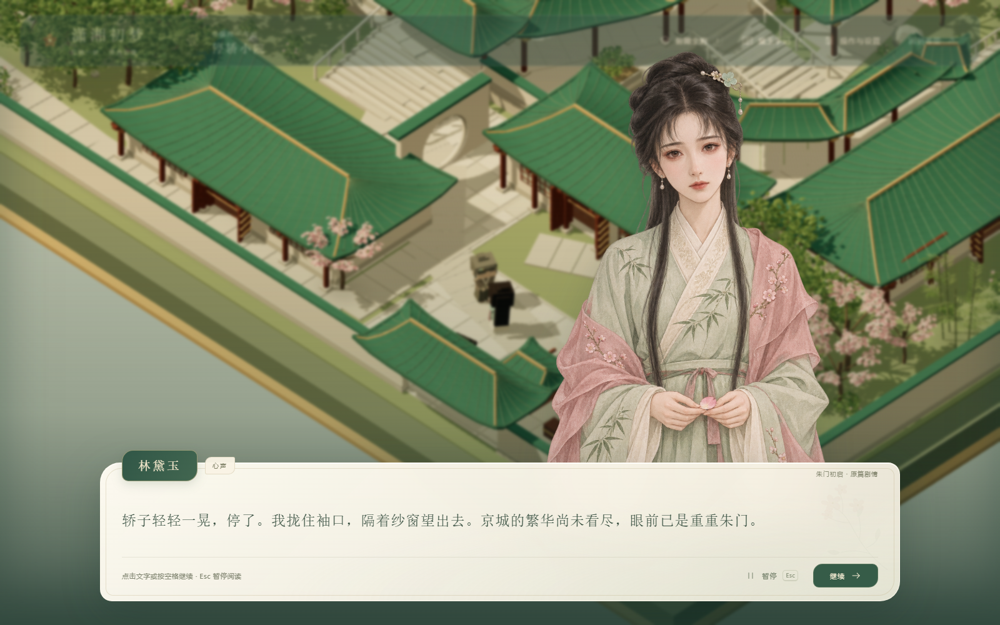

# 三维贾府漫游 · 循话游府版 V11.8

《潇湘初梦》第一幕“黛玉进贾府”的三维探索模式。本版在完整开始页和卷宗入口上加入九段空间叙事，人物分散在全府：斜俯视镜头下控制方块小黛玉在院落、曲廊、亭台、假山和八间内室中自由探索，交谈时显示对应人物的水彩立绘和纸笺对话。





## 直接运行

推荐安装 Node.js 22.12 或更高版本。此目录的 `dist/` 已包含可运行页面，无需先安装 npm 依赖。

在仓库根目录执行 `npm start`，打开 http://127.0.0.1:4177/ ，从开始界面“展卷入梦”选择第一卷。Windows 双击根目录 `启动潇湘初梦.cmd`；旧三维启动脚本也会转入完整入口。

[下载合并版即玩包与完整可编辑模型](https://github.com/nayoagan-ship-it/xiaoxiang-first-dream/releases/tag/jiafu-v11.8.0)。即玩包完整解压后双击启动脚本；模型包用于继续编辑，运行游戏只需即玩包。公开网址与本地版现使用相同的开始界面和章节入口，第一卷接入三维贾府，第二卷保留黛玉葬花。

## 本版内容

- 九段相逢串起门前、正房、绣房、茶房、书阁、高亭、后院、水亭和住处；正房仅留贾母，主要人物分散在各处。
- 迎春、探春、惜春三人的顺序可自选，其他剧情顺着对话提示衔接；提前探索不会跳过故事。无倒计时和强制传送。
- 新增61个游府剧情节点；对话、分支选择、暂停与续读按段保存，评分不会因重复进入或刷新而叠加。手记保留相逢和物件发现。
- “顺着话头”可记下地图位置，或选择循路前往；茶房需亲手开门，登亭与曲桥均可实际行走。


- 青黛宣纸 UI：花枝暗纹、柔和圆角、导航图标、探索进度、手记空白页和阅读设置。人物对话新增可点击的暂停按钮，Esc 仍可暂停；浏览器旧存档继续使用。
- 八片连通区域与八间可进入的内室，建筑、地形有明显高差，保留假山穿洞、登亭石阶和曲折水桥。
- 玩家黛玉、八位具名NPC及两位门前人物。人物有不同站姿、小方眼、眨眼、呼吸和交谈回应，靠近时转向黛玉。
- 十位可交谈人物及原篇通报丫鬟都有对应水彩立绘；黛玉回应或心声时切回黛玉。快速翻页和暂停可正确清理旧图像。
- 保留原篇选择、心境分数、阅读续接、物件交互、手记、开门状态和独立浏览器存档。

操作：WASD / 方向键移动，点击地面寻路，E交互，F切换俯瞰 / 跟随，滚轮缩放，J手记，M地图，Esc暂停。对话中空格 / 回车继续，数字1/2/3选择。面向电脑浏览器设计。

## 继续开发

```sh
cd jiafu-3d
npm ci
npm run dev
```

开发地址为 http://127.0.0.1:4176/ 。在仓库根目录运行 `npm run build` 更新完整游戏，或在此目录运行 `npm run build` 仅更新三维构建 `dist/`，`npm run check` 检查入口语法，`npm test` 检查方块几何与人物动作。

可选浏览器检查需 Playwright：`npm install --no-save --package-lock=false playwright`、`npx playwright install chromium`。保持开发服务运行后执行 `node tools/check-exploration-browser.cjs`。`npm test` 另覆盖全部六种姊妹顺序与连续通行；浏览器检查默认开发端口4176，可用 `JIAFU_EXPLORATION_URL` 更改。构建版启动后执行 `node tools/check-ui-browser.cjs` 检查三个桌面尺寸、阅读设置、剧情选择、暂停与续读；可通过 `JIAFU_UI_URL` 指向独立测试端口。使用本机浏览器时，可设置 `JIAFU_BROWSER_EXECUTABLE`；复用外部 Playwright 时可设置 `JIAFU_PLAYWRIGHT_PACKAGE` 为其模块路径。

## 目录与模型

`src/` 为地图、建筑、室内、植被、人物与对话逻辑，`src/ui-theme.css` 为合并版界面主题；`public/assets/` 为运行素材；`tools/` 为模型导出与验证工具；`outputs/` 为实际渲染截图及检查记录。

`assets/jiafu-block-characters-v11.blend` 和 `.glb` 包含独立九人可编辑模型。完整地图的BLEND/GLB体积较大，可使用V11.5模型包继续编辑；本版人物站位与剧情由代码配置，旧整府模型不包含新站位。也可执行 `node tools/export-map.mjs`，再用Blender后台运行 `tools/save-blender-map.py` 重建整府和九人模型。

模型保存当前姿态与分组层级；呼吸、眨眼、交谈与屋顶剖开由网页代码实时驱动，未烘焙为模型动画片段。

新增立绘使用内置image_gen，以原有黛玉立绘为参考，说明及完整提示词见 [ASSET-NOTES.md](public/assets/portraits-v11/ASSET-NOTES.md) 和 [prompts.json](public/assets/portraits-v11/prompts.json)。人物与空间为小说游戏的艺术化设计。

项目代码沿用仓库根目录MIT许可；Three.js许可保留于 `THREE-LICENSE.txt`。新增素材与源代码一同提供，既有素材及署名说明见仓库根目录 `SOURCES.md`。
